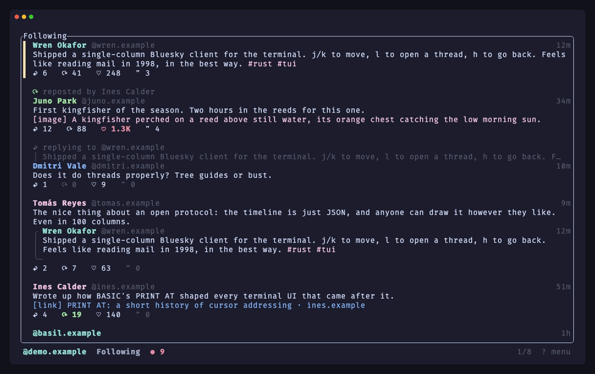

# at-tui

A keyboard-first Bluesky client for the terminal: one column of posts, vim-style movement, and a stack of views you open and back out of, the way you'd read mail in mutt.



<sub>Recorded with [VHS](https://github.com/charmbracelet/vhs) against a local mock server with made-up accounts; re-record with `demo/record.sh`.</sub>

## Features

- Read and page through your Following timeline, saved feeds, your own posts, profiles, threads, and notifications.
- Threads drawn as a tree. Notifications grouped per post ("Ana, Ben and 4 others liked your post"), with the text of the post they're about.
- Like, repost, follow, post, reply, quote, and delete your own posts. Links and @mentions become rich text.
- Compose in the built-in editor or hand the draft to `$VISUAL`/`$EDITOR`. Drafts survive Esc and failed sends.
- Images in the terminal (Kitty, Sixel, iTerm2, or half-blocks). Video through mpv.
- Several accounts; switch between them, and between saved feeds, from the menu.
- Background refresh with a count of new posts and unread notifications. Expired sessions refresh themselves, so the app keeps working after the two-hour token lifetime.

## Requirements

- Rust 1.90 or newer (2024 edition).
- A Bluesky account and an [app password](https://bsky.app/settings/app-passwords). OAuth isn't supported yet.
- Any terminal. Images use the best protocol your terminal offers and fall back to half-block characters.
- Optional: [mpv](https://mpv.io) for video. Terminals with Kitty graphics (kitty, Ghostty) play it in place; elsewhere it opens in an mpv window.

## Install

```sh
cargo install --git https://github.com/animegolem/AT-TUI --tag v1.0.0 --locked
```

Or from a checkout: `cargo install --path . --locked`. Either way you get an `at-tui` binary.

## Quickstart

```sh
at-tui login     # prompts for your handle and app password
at-tui           # start the client
```

Press `?` (or Esc at the timeline) for the menu: your feeds and accounts, every key, and the image setting.

Managing accounts:

```sh
at-tui login --account work      # add another account under a label
at-tui accounts                  # list them; * marks the active one
at-tui switch work
at-tui logout work
at-tui session                   # active account, and the image protocol in use
```

## Keys

**Timeline, threads, profiles, notifications**

| Key | Action |
| --- | --- |
| `j` `k` / `↓` `↑` / mouse wheel | Move |
| `Ctrl-d` `Ctrl-u` · `PgDn` `PgUp` | Half page · page |
| `g` `G` | Top · bottom |
| `l` / `Enter` / `→` | Open the thread (or what a notification is about) |
| `h` / `←` | Back |
| `Esc` | Back; at the timeline, open the menu |
| `q` | Back; at the timeline, quit |
| `P` · `N` · `e` | Author's profile · notifications · the quoted post |
| `Space` · `o` | Media viewer · open a link (picks if there are several) |
| `f` · `b` · `F` · `d` | Like · repost · follow the author · delete your post |
| `p` · `r` · `Q` | New post · reply · quote |
| `[` `]` · `Tab` | Previous/next feed · feed and account switcher |
| `/` · `n` | Search loaded posts · next match |
| `R` · `u` | Reload · show new posts |
| `?` | Menu |
| `Ctrl-C` | Quit, from anywhere |

**Menu and switcher:** `j`/`k` move through feeds and accounts, `Enter` switches, `Esc` closes. Nothing switches until you press `Enter`.

**Media viewer:** `h`/`l` previous/next, `Enter` or `p` plays a video in mpv, `u` opens it in your browser, `Space`/`Esc` closes.

**Composer:** type or paste; `Enter` is a newline. `Ctrl-S` sends, `Ctrl-W` deletes a word, `Ctrl-U` clears the line, `Ctrl-E` edits in `$VISUAL`/`$EDITOR`. `Esc` closes and keeps the draft for the same post.

**Delete confirmation:** `y` deletes; any other key cancels.

Pastes go only into the composer or the search prompt; a paste anywhere else is ignored, so stray text can't trigger likes or follows. Links open in your browser only if they're `http(s)`.

## Configuration

| Option | Effect |
| --- | --- |
| `--image-protocol auto\|kitty\|sixel\|iterm2\|halfblocks` | Force an image protocol (default `auto`) |
| `--no-images` | Text only |
| `--service <url>` | Log in through another PDS or entryway (default `https://bsky.social`) |
| `AT_TUI_MPV` | Path to mpv, if it isn't on `PATH` or in a standard Homebrew location |
| `AT_TUI_ACCOUNTS_FILE` | Use a different accounts file |
| `VISUAL` / `EDITOR` | Editor for `Ctrl-E` (default `vi`) |

Accounts are stored in your platform's config directory (`~/Library/Application Support/dev.haiti-plan.at-tui/` on macOS, `~/.config/at-tui/` on Linux) with owner-only permissions. Images are cached in the platform cache directory, capped at 256 MiB and 30 days.

## How the timeline behaves

- **Following** follows your Bluesky feed preferences for replies, reposts, and quote posts. With no preference set, it shows replies only between people you follow, like the official app.
- Saved feeds appear under their real names. A **Your Posts** feed is added for the active account.
- New posts are merged in when you're at the top, and counted in the statusline otherwise. `u` merges them.

## Not yet supported

OAuth login, image and video upload, direct messages, mute/block and content-label controls, list feeds, and search beyond the posts already loaded. Accounts on a self-hosted PDS need `--service` at login.

## License

MIT. See [LICENSE](LICENSE).
